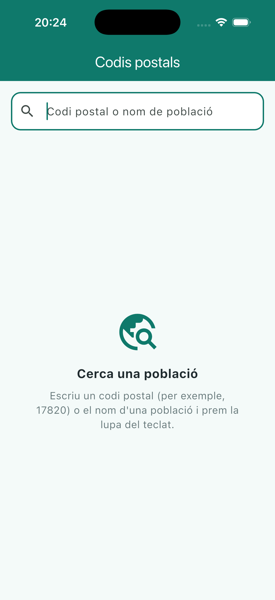
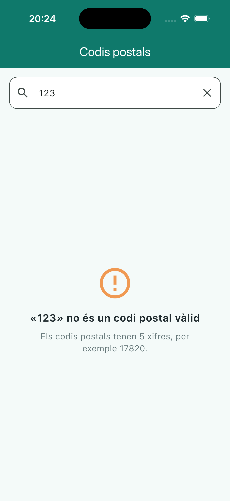
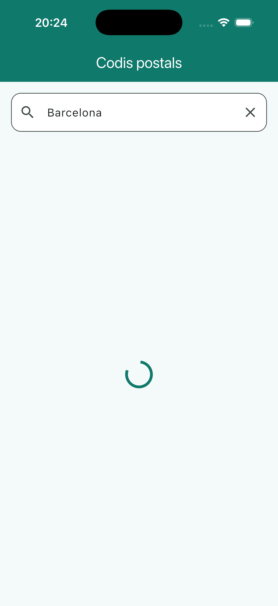
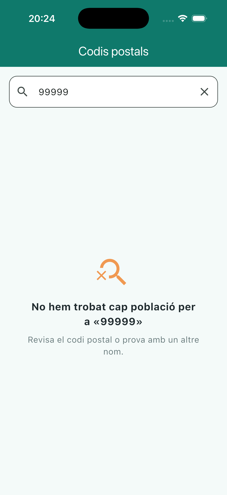
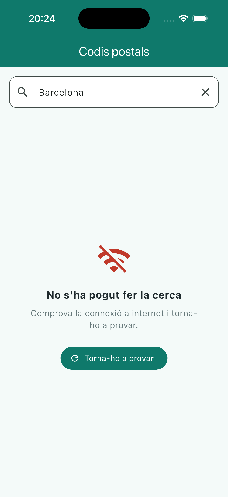
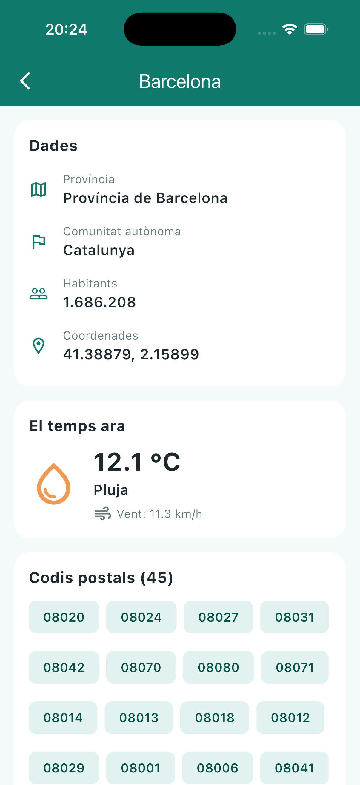

# Codis postals · Activitat d'avaluació 1.4 — Una app amb API

App en **Flutter** que busca poblaciones de España por **código postal** o por **nombre**, usando la API de geocodificación de [Open-Meteo](https://open-meteo.com/). Al tocar una población se ve su ficha completa, con todos sus códigos postales y el tiempo que hace ahora.

**Nivel alcanzado:** Base ✅ · Ampliació ✅ · Repte: el tiempo ✅ (las búsquedas recientes no están hechas)

## Capturas

### Pantalla de búsqueda: sus estados

| Al abrir | Código no válido | Cargando |
|:---:|:---:|:---:|
|  |  |  |

| Resultados | No encontrado | Error (sin conexión) |
|:---:|:---:|:---:|
|  |  |  |

### Detalle de una población

| Barcelona: datos, el tiempo y 45 códigos postales |
|:---:|
|  |

> Capturas hechas en el simulador de iPhone 17.

## Qué hace la app

### Base
| Requisito | Cómo lo he hecho |
|---|---|
| Modelos | `SearchResponse` y `Place`, generados con quicktype a partir de la respuesta de «Sant Pere» (donde algunas poblaciones no tienen `population` ni `postcodes`), así que quedan como `int?` y `List<String>?` |
| Respuesta sin resultados | Con el `99999` la API no devuelve una lista vacía, sino que no hay clave `results`. En `SearchResponse.fromJson`, si es `null` se usa una lista vacía |
| Búsqueda | `TextField` con `textInputAction: TextInputAction.search` y `onSubmitted`: se busca con la lupa del teclado |
| Resultados | Lista con el nombre, la provincia y la comunidad. El `17469` muestra sus seis poblaciones |
| Estados | Un `enum SearchStatus` y un `switch` deciden qué se pinta: al abrir, código no válido, cargando, resultados, no encontrado y error |
| No encontrado ≠ error | Si la respuesta llega bien pero sin resultados → «no encontrado». Si la petición falla (sin internet o `statusCode` distinto de 200) → «error», con un botón para volver a intentarlo |

### Ampliació
- `PlaceDetailScreen` recibe la `Place` elegida y muestra el nombre en la barra, la provincia, la comunidad, los habitantes (con separador de miles, o «Sense dades» si faltan), las coordenadas y todos los códigos postales.
- Los códigos postales van en un `Wrap` de `Chip`s: Barcelona tiene 45 y saltan de línea solos, sin overflow.
- Se abre con `Navigator.push`, así que al volver atrás la pantalla de búsqueda sigue ahí con sus resultados.

### Repte: el tiempo
- Segunda llamada a la API del tiempo de Open-Meteo con las coordenadas de la población.
- Modelos `WeatherResponse`, `Current` y `CurrentUnits`, uno por archivo.
- El detalle es un `StatefulWidget`: el `Future` se crea una sola vez en `initState` y se muestra con un `FutureBuilder`.
- Esta parte tiene sus propios estados (cargando, error con botón de reintentar, datos). Si falla, el resto del detalle se sigue viendo.
- `weather_code` se traduce a una descripción y un icono según la tabla del enunciado.

### Extras
- **Código no válido:** si se escriben solo cifras pero no son cinco (por ejemplo `123`), se avisa sin llamar a la API.
- **Botón ✕** para borrar el campo. Al vaciarlo, la pantalla vuelve al estado inicial en lugar de dejar los resultados anteriores.
- Si se lanza una búsqueda nueva antes de que termine la anterior, la respuesta antigua se ignora.

## Estructura del código

```
lib/
├── main.dart
├── models/
│   ├── current.dart
│   ├── current_units.dart
│   ├── place.dart
│   ├── search_response.dart
│   ├── search_status.dart
│   └── weather_response.dart
├── screens/
│   ├── place_detail_screen.dart
│   └── search_screen.dart
├── services/
│   ├── geocoding_api.dart       ← búsqueda de poblaciones
│   └── weather_api.dart         ← el tiempo actual
├── styles/
│   └── app_styles.dart          ← colores, espacios, medidas y estilos de texto
├── utils/
│   ├── number_format.dart       ← 1686208 → "1.686.208"
│   └── weather_code.dart        ← weather_code → descripción e icono
└── widgets/
    ├── info_row.dart
    ├── place_tile.dart
    ├── postcode_chips.dart
    ├── section_card.dart
    ├── status_message.dart      ← icono + título + mensaje (+ botón), usado en varios estados
    └── weather_info.dart
```

**Buenas prácticas**
- Una clase por archivo; en la raíz de `lib` solo está `main.dart`.
- Todos los colores, espacios y estilos de texto salen de `AppStyles`. Los colores de la barra superior se definen una sola vez en el tema.
- Las llamadas a las APIs están en `services/`, separadas de las pantallas.
- Nombres de código en inglés; textos de pantalla en catalán, igual que los nombres que devuelve la API (`language=ca`).
- `flutter analyze`: sin errores ni avisos.

## Cómo ejecutarlo

```bash
flutter pub get
flutter run
```

## Reflexión

**Cómo me puse.** Antes de escribir código abrí la API en el navegador y probé los casos del enunciado: `17820`, `17469`, `99999` y «Sant Pere». Ver el JSON real me ayudó mucho: con el `99999` vi que no hay lista vacía, sino que falta la clave `results`, y con «Sant Pere» que algunas poblaciones no tienen habitantes ni códigos postales. Después fui por partes: modelos, búsqueda, estados, lista, detalle y, al final, el tiempo, haciendo un commit al terminar cada una.

**Qué salió bien.** Usar un `enum` para los estados de la pantalla hizo el código muy claro: hay una sola variable que dice en qué estado está la pantalla, y el `switch` obliga a tratar todos los casos. Separar las llamadas a la API en `services/` también dejó las pantallas mucho más limpias. Y el `FutureBuilder` del tiempo funcionó a la primera: si falla el tiempo, el resto del detalle se ve igual.

**Qué me costó.**
- **quicktype.** La primera vez copié el JSON desde la vista de árbol del navegador en lugar del texto original, y quicktype no lo entendía. Luego, al cambiar el nombre de `Result` a `Place`, se me cambió también el campo `results` por `Places`, y la app habría petado en todas las búsquedas porque esa clave no existe en el JSON.
- **El campo `elevation`.** quicktype lo generó como `int`, pero en la respuesta real viene como `168.0`. En Dart eso es un `double` y la app habría petado. Lo descubrí mirando la respuesta en bruto de varias búsquedas, y lo cambié a `double` con `toDouble()`.
- **El entorno.** El simulador de iOS tarda más de 60 segundos en arrancar la primera vez y VS Code daba error de tiempo de espera. La solución fue arrancar primero el simulador y después ejecutar la app. Además, como mi Mac usa el teclado chino (Pinyin), lo que escribía no llegaba bien al simulador, y tuve que usar el teclado en pantalla.

**Qué me sorprendió.**
- Un error que encontré probando: si borraba el texto del buscador, los resultados de la búsqueda anterior seguían en la pantalla, porque la pantalla solo cambiaba al pulsar la lupa. Lo arreglé escuchando también `onChanged`, para volver al estado inicial cuando el campo queda vacío, y añadí un botón ✕ para borrarlo de golpe.
- El estado «cargando» casi no se ve porque la API responde muy rápido. Para hacer la captura tuve que añadir un retraso temporal de 3 segundos, que después quité.
- Probé también `language=es`: funciona igual, pero los nombres quedan mezclados (por ejemplo «Província de Lérida» o «Bañolas» junto a «Girona»), así que me quedé con `language=ca` como pide el enunciado.

**Qué he aprendido.**
- A hacer peticiones HTTP con `http.get`, `async` y `await`, y a distinguir entre «la respuesta ha llegado pero no hay datos» y «la petición ha fallado».
- A convertir JSON en clases de Dart con quicktype y, sobre todo, a no fiarme del todo de lo que genera: hay que revisar los tipos con datos reales.
- A tratar los datos que pueden faltar con tipos nulables (`int?`) y el operador `??`.
- A navegar entre pantallas con `Navigator.push` pasando datos, y por qué al volver los resultados siguen ahí.
- A usar `FutureBuilder`, y por qué el `Future` se crea en `initState` y no dentro de `build` (si no, se haría una petición nueva cada vez que se redibuja la pantalla).

**Qué cambiaría.** Me faltó tiempo para las búsquedas recientes del Repte; sería lo siguiente que haría, guardándolas en el móvil con un paquete como `shared_preferences`. También probaría desde el principio casos raros, como borrar el texto o buscar dos veces seguidas, en lugar de encontrarlos al final.

---

Datos: [Open-Meteo](https://open-meteo.com/) (licencia CC BY 4.0), a partir de GeoNames.
